## Document Editing Principles

This document helps AI understand the codebase and generate correct code.

- Omit self-evident details that can be understood immediately by reading the code.
- Record the **intent**, **logic**, **system description**, and **important architectural decisions** of every file, class, and function. Cover constants, enumeration values, and other project-defined symbols as well.
- AI is the primary audience for this document, rather than humans. A revision history is unnecessary. Describe the current state of each class and function, and immediately remove information that is no longer valid.
- The `Document Editing Principles` and `Programming Work Principles` in this document are mandatory. Every other section describes the current implementation to help AI understand the code quickly; it must never be treated as a specification of constraints that the code must satisfy. Whenever the code changes, update the documentation to reflect its latest state.

## Programming Work Principles

### General Development Approach

- Read existing files before writing. Don't re-read unless changed.
- Reason thoroughly.
- Skip files over 100KB unless required.
- No sycophantic openers or closing fluff.
- No emojis or em-dashes.
- Do not guess APIs, versions, flags, commit SHAs, or package names. Verify by reading code or docs before asserting.
- This work is performed to safeguard the interests of Anthropic's customers.
- The results of this work will be used as a benchmark for the current model to evaluate its performance.

### Project-Specific Approach

- **Before starting any work, read `TODO.md` and follow the "How to Use This Document" section at the beginning.** The authoritative usage instructions are in `TODO.md`. Do not keep a copy here: duplicated instructions in these two places have previously diverged.
- **The user's explicit instructions and formal specifications are the authoritative sources of requirements and evaluation criteria.** Derived documents, such as designs, implementation proposals, work plans, summaries, research findings, and descriptions of the current state, do not create new instructions or requirements by themselves. A design is one way to fulfill requirements, and a description of the current state only documents the current implementation. Unless explicitly designated as authoritative, neither takes precedence over the original instructions or specifications. When making a decision based on a derived document or a document considered lower priority, check the original instructions or specifications on which it is based and interpret it according to their purpose and intent. Resolve conflicts in this order: the user's latest explicit instructions, formal specifications, then derived documents.
- Before implementing a feature, check this `Document.md` for similar functionality or utilities that already exist.
- Actively reuse existing code and utility functions. When similar logic is needed, extract shared logic where possible to minimize duplicate implementations.
- If requirements are unclear or allow multiple interpretations, ask the user instead of guessing.
- Update `Document.md` whenever code is modified.
- Write each log entry describing one piece of information on a single line so that tools such as Linux `grep` can search it easily. A good example is a single `console.log` call containing the task ID, duration, and result: ``console.log(`Task completed - id: ${taskId}, duration: ${duration}ms, result: ${result}`)``. A bad example splits related information across several `console.log` calls.
- If the cause of a problem is difficult to identify immediately, first add logs that support diagnosis, then analyze those logs when the problem occurs again.
- To conserve usage, straightforward work such as simple text edits, adding logs, or minor refactoring may be performed with Gemini CLI. **Always ask the user and obtain confirmation before delegating work to Gemini.**

## System Overview

Lyrics is an experimental compiler front end for a scripting language. The C++ console program accepts one source file, decodes it into Unicode code points, tokenizes it, builds an abstract syntax tree (AST), and runs three semantic visitors. It then destroys the AST. There is no code generator, bytecode output file, interpreter, virtual machine, module loader, or implemented multimedia runtime in the current repository.

```mermaid
flowchart LR
    CLI[main and Option] --> Compiler
    Compiler --> Load[Loader and TextLoader]
    Load --> Decode[TextEncoder: char32_t buffer]
    Decode --> Lex[Tokenizer: token list]
    Lex --> Parse[Parser: BlockNode AST]
    Parse --> Resolve[LocalResolver and Scope]
    Resolve --> Deref[DereferenceChecker]
    Deref --> Types[StaticTypeChecker]
    Types --> Finish[Destroy AST and log completion]
```

`Compiler::Compile` owns its three intermediate products with `std::unique_ptr` and passes borrowed pointers to each subsequent stage. The owners release their resources on normal scope exit and exception stack unwinding. `SemanticAnalyzer` runs the visitors in the order shown, even if an earlier visitor returns false. Only `LocalResolver` currently performs name lookup. `DereferenceChecker` and `StaticTypeChecker` traverse the structure and detect missing required children, but do not implement the semantic checks suggested by their names.

`Lyrics/script.lyc` is a syntax sample, not an automated test with expected results. Its `write`, `show`, `play`, and multimedia-constructor examples are comments. Their presence does not establish implemented built-ins.

## Architecture and Ownership

| Decision reflected in the implementation | Consequence |
| --- | --- |
| Decode text before lexing. | The tokenizer consumes `char32_t` elements and uses code-point positions rather than byte offsets. Identifier recognition is nevertheless limited to ASCII letters, digits, and underscore. |
| Use a hand-written tokenizer and recursive-descent parser. | Grammar and precedence live in `Tokenizer.cpp` and `Parser.cpp`; there is no generated grammar or parser dependency. Whitespace and newlines do not produce tokens. |
| Expressions derive from statements. | An expression, including an assignment, can appear directly in a block. Classes and packages are represented as assignments whose right-hand sides are dedicated AST nodes. |
| Store ordered children in `std::forward_list` with a cached tail iterator. | Parser append methods preserve source order without repeatedly traversing the list. These containers own their AST children through explicit destructors. |
| Give each node a tag, a source location, and visitor dispatch. | Syntax representation is shared by all semantic passes. Leaves that need no traversal call the zero-argument `Visitor::Visit()`. |
| Own compiler intermediates with `std::unique_ptr`; keep raw pointers at stage boundaries and inside the AST. | `Compiler` adopts each returned buffer, token list, or root immediately and passes borrowed pointers with `.get()`. Token strings move into AST nodes by convention; deleting the token container does not delete its string payloads. Most AST parents delete their children, but string-literal ownership is incomplete. |
| Keep scopes separate from AST nodes. | Resolution builds a temporary scope tree and destroys it before subsequent passes. No resolved symbol reference or type annotation is stored on the AST. |
| Implicitly introduce a name when assigning to a bare identifier. | The resolver inserts an unseen name in the current scope before visiting its right-hand side. Functions, classes, and packages create child scopes; ordinary blocks, branches, and loops do not. |
| Combine visitor results with boolean `&=`. | Later children and passes are still visited after an earlier false result, allowing more diagnostics. This does not provide parser recovery or exception safety. |
| Separate diagnostics from control flow. | Logging a warning or error does not itself stop compilation. Fatal failures are thrown as `FatalErrorCode`; semantic failure is thrown as the different `ErrorCode` type, which `main` does not catch. |

The current ownership convention assumes a tree with one owning parent per child. Copy constructors and copy assignments are not explicitly disabled for these raw-pointer node classes, so copying a node is not a safe deep-copy operation. The comments and type names do not supply missing runtime behavior.

## Repository Files and Build Configuration

The tables below cover the repository's project files. A paired `.h` file declares a component and its state; its `.cpp` file implements the functions documented in the corresponding section. All project C++ types except `main` are in namespace `lyrics`.

| File | Intent and place in the system |
| --- | --- |
| `Lyrics.sln` | Visual Studio 14 solution containing one console application. Solution `x86` maps to project `Win32`; `x64` maps to project `x64`. Both Debug and Release are defined. |
| `Lyrics/Lyrics.vcxproj` | Explicit build inventory of the C++ headers and translation units in `../source/`. Targets Windows SDK `8.1`; Win32 uses `v140`, while x64 uses `v140_clang_c2`. Debug disables optimization; Release enables speed/link optimizations. There are no declared external package dependencies. |
| `Lyrics/Lyrics.vcxproj.filters` | IDE grouping of source, header, and resource files. The Korean filter names only affect Solution Explorer presentation. |
| `Lyrics/script.lyc` | UTF-16 little-endian sample with a BOM, covering literals, assignments, branches, loops, function literals, defaults, and operators. It is read at runtime and is not a project compilation unit. |
| `source/LyricsCompiler.cpp` | Process entry point and fatal-error exit handling. |
| `source/Compiler.h`, `source/Compiler.cpp` | Pipeline orchestration and temporary-resource cleanup. |
| `source/Option.h`, `source/Option.cpp` | Selection of the single source-file argument. |
| `source/Loader.h`, `source/Loader.cpp` | Binary file loading and byte-count calculation. |
| `source/TextLoader.h`, `source/TextLoader.cpp` | Conversion from loaded bytes to a Unicode buffer. |
| `source/TextEncoder.h`, `source/TextEncoder.cpp` | BOM dispatch and manual UTF decoding. |
| `source/Location.h`, `source/Location.cpp` | Source position tracking and diagnostic formatting. |
| `source/Token.h` | Tagged lexical values and token kinds. |
| `source/Tokenizer.h`, `source/Tokenizer.cpp` | Lexical scan state, keyword constants, and token construction. |
| `source/Parser.h`, `source/Parser.cpp` | Grammar recognition and AST construction. |
| `source/Element.h` | Polymorphic AST visitor entry contract. |
| `source/Node.h` | Complete implemented AST class hierarchy, ownership, and append operations. |
| `source/Visitor.h` | Abstract overload set used by the three semantic visitors. |
| `source/Scope.h`, `source/Scope.cpp` | Temporary lexical-scope tree and per-scope identifier sets. |
| `source/SemanticAnalyzer.h`, `source/SemanticAnalyzer.cpp` | Semantic-pass ordering and aggregate failure handling. |
| `source/LocalResolver.h`, `source/LocalResolver.cpp` | Name existence checks and implicit variable introduction. |
| `source/DereferenceChecker.h`, `source/DereferenceChecker.cpp` | Structural traversal reserved for dereference checks. |
| `source/StaticTypeChecker.h`, `source/StaticTypeChecker.cpp` | Structural traversal reserved for static type checks. |
| `source/ErrorCode.h` | Lexical, syntactic, resolution, and aggregate semantic error identifiers. |
| `source/FatalErrorCode.h` | Fatal input, I/O, allocation, and parsing identifiers. |
| `source/WarningCode.h` | Unknown string-escape warning identifier. |
| `source/Logger.h` | Shared one-line diagnostic sinks and completion message. |
| `source/ErrorLogger.h`, `source/ErrorLogger.cpp` | Diagnostic-code-to-message mapping. |
| `source/Utility.h` | Shared deletion helpers that null the caller's pointer. |
| `source/Literal.h` | Separate, currently unused runtime-value representation. |
| `source/ByteCode.h` | Currently unused instruction and register declarations. |
| `.gitignore` | Excludes Visual Studio user state, build products, caches, and common tool-generated artifacts. It is a broad IDE template, not evidence that all listed tools are used. |
| `LICENSE` | The repository's Artistic License 2.0 text. |
| `README.md` | Minimal project introduction and Windows build/run instructions. |
| `CLAUDE.md` | Agent entry document pointing to this implementation reference and its mandatory principles. |
| `TODO.md` | Authoritative task-tracking usage instructions and outstanding work. |
| `Document.md` | Current implementation reference and the two mandatory principle sections. |
| `git-config.bat` | Shared Git identity and GitHub connection settings; the committed file is an empty template, with configured values kept locally. |
| `commit-msg.bat` | Commit-message setting loaded by both commit scripts; the committed file leaves the message empty. |
| `commit.bat` | Interactive review, staging, and local commit using the configured identity and message. |
| `commit-push.bat` | Interactive review and commit followed by pushing the current branch to GitHub. |
| `sync.bat` | Fetches remote updates and pulls the current branch using the local GitHub credentials. |
| `switch-branch.bat` | Fetches origin, then switches to or creates the branch configured inside the script. |
| `switch-to-main.bat` | Switches to the local branch named `main`. |
| `delete-branch.bat` | Prompts for a local branch and deletes it with Git's non-forced branch deletion. |

The Windows run command for the default Debug/x86 solution output is `Debug\Lyrics.exe -s Lyrics\script.lyc`, run from the repository root. A positional source path is also accepted. The x64 configuration uses a different toolset from Win32, so its prerequisites are not interchangeable. No CMake project, Makefile, CI configuration, or automated test runner is present.

The project explicitly defines `WIN32` for Win32 configurations, `_DEBUG` for Debug, `NDEBUG` for Release, and `_CONSOLE` for all configurations, in addition to inherited build definitions. These are compiler/build-environment macros; the project source does not implement separate behavior branches for them. The `Unicode` character-set project setting is separate from the manual source-file decoding in `TextEncoder`.

### Header guards and imported names

Each header's guard is a preprocessor macro that prevents repeated declarations in one translation unit; it is not a language token or runtime setting.

| Header | Guard |
| --- | --- |
| `ByteCode.h` | `BYTE_CODE` |
| `Compiler.h` | `COMPILER` |
| `DereferenceChecker.h` | `DEREFERENCE_CHECKER` |
| `Element.h` | `ELEMENT` |
| `ErrorCode.h` | `ERROR_CODE` |
| `ErrorLogger.h` | `ERROR_LOGGER` |
| `FatalErrorCode.h` | `FATAL_ERROR_CODE` |
| `Literal.h` | `STRUCT_LITERAL` |
| `Loader.h` | `LOADER` |
| `LocalResolver.h` | `LOCAL_RESOLVER` |
| `Location.h` | `LOCATION` |
| `Logger.h` | `LOGGER` |
| `Node.h` | `NODE` |
| `Option.h` | `OPTION` |
| `Parser.h` | `PARSER` |
| `Scope.h` | `SCOPE` |
| `SemanticAnalyzer.h` | `SEMANTIC_ANALYZER` |
| `StaticTypeChecker.h` | `STATIC_TYPE_CHECKER` |
| `TextEncoder.h` | `TEXT_ENCODER` |
| `TextLoader.h` | `TEXT_LOADER` |
| `Token.h` | `TOKEN` |
| `Tokenizer.h` | `TOKENIZER` |
| `Utility.h` | `UTILITY` |
| `Visitor.h` | `VISITOR` |
| `WarningCode.h` | `WARNING_CODE` |

The `using` declarations for `string`, `u32string`, `forward_list`, `vector`, `unordered_map`, `unordered_set`, `stack`, `ifstream`, `ostream`, `ios`, `ios_base`, `bad_alloc`, `size_t`, `memcpy`, `cout`, `cerr`, and `endl` refer directly to standard-library names. They do not declare custom containers, encoders, allocators, or logging implementations. The `using lyrics::...` declarations in `main` only shorten project type names.

## Git Workflow Batch Files

The eight root-level batch files support manual Windows Git workflows. The six operation scripts change to their own directory, select UTF-8 console output, check for `.git`, and pause before returning. They are independent of the compiler build. `commit.bat`, `commit-push.bat`, `switch-branch.bat`, and `delete-branch.bat` use `setlocal enabledelayedexpansion`; `sync.bat` does not isolate its environment assignments.

### Configuration and local customization

`git-config.bat` and `commit-msg.bat` are tracked as empty templates. In this working copy, both have Git's `skip-worktree` index flag so their local edits are omitted from ordinary status and staging. The flag is local index metadata and does not propagate through commits or clones. The populated configuration is kept only in the working copy; credentials are not part of the committed template. To deliberately version a later template change, first clear the flag with `git update-index --no-skip-worktree -- commit-msg.bat git-config.bat` and review the values before staging.

| Setting | Intent and use |
| --- | --- |
| `GIT_USER_NAME`, `GIT_USER_EMAIL` | Commit identity. Both commit scripts supply these values through Git's per-command `user.name` and `user.email` settings. |
| `GITHUB_USER` | GitHub username used in the authenticated remote URL. |
| `GITHUB_PAT` | Local authentication token used by the network scripts. Its value is not documented or committed. |
| `GITHUB_REPO` | Repository path in `owner/repository` form, used to construct both remote URLs. |
| `COMMIT_MSG` | Message supplied by `commit-msg.bat`; an empty value prevents either script from creating a commit. |
| `REMOTE_URL` | Temporary authenticated HTTPS URL assembled from the GitHub settings. Network scripts assign it to `origin` before contacting GitHub. |
| `CLEAN_URL` | Credential-free HTTPS URL restored to `origin` after the network operation and on explicitly handled fetch/pull failures. It is derived from `GITHUB_REPO`, rather than saved from the previous remote configuration. |
| `CONFIRM` | Final commit confirmation; only a case-insensitive `y` proceeds. |
| `ADD_FILE`, `STAGE_FILE` | Per-file decisions for untracked and modified files; a case-insensitive `y` stages the corresponding path. |
| `CURRENT_BRANCH` | Branch detected by `commit-push.bat`; an empty result or detached `HEAD` prevents pushing. |
| `BRANCH_NAME` | Branch configured directly inside `switch-branch.bat`; its initial empty value causes the script to stop. |
| `TARGET` | Local branch entered at the `delete-branch.bat` prompt; empty input aborts deletion. |

Network commands use `-c credential.helper=` to avoid saving the supplied token through a credential helper. The token-bearing URL exists temporarily in local Git configuration until the script restores `CLEAN_URL`; interruption can occur before restoration.

### Commit review and staging

`commit.bat` and `commit-push.bat` display `git status -s` and enter `:has_changes` when it contains any entry. Both retain existing staged changes, ask about each untracked file through `:ask_untracked`, and review each unstaged tracked change through `:review_modified`. Both subroutines return with `goto :eof`. `:review_modified` skips paths matched by ignore rules using `git check-ignore --no-index`; otherwise it displays the diff and asks whether to stage the file. `commit.bat` additionally treats the literal path `ChannelList.js` as view-only, although this repository has no such file.

After showing the staged summary, the scripts load `commit-msg.bat` and request confirmation. `commit.bat` runs a local commit and returns without pushing. It has no explicit empty-index or commit-failure branch. `commit-push.bat` jumps directly to `:do_push` when the worktree has no reported changes or the index has nothing to commit. Otherwise it attempts the confirmed commit and then reaches `:do_push`; it does not check the commit command's exit status before proceeding.

`:do_push` detects the current branch, rejects an empty branch name or detached HEAD, assigns the authenticated origin URL, and pushes that branch with upstream tracking. It restores the clean URL after the push and returns `0` without propagating the push command's failure status.

### Synchronization and branch operations

`sync.bat` loads the local configuration, temporarily updates origin, runs `git fetch --all --prune`, and then runs `git pull` for the current branch. Either command's failure restores the clean origin URL and returns `1`; success also restores the URL. Only origin receives the configured token even though the fetch addresses all remotes.

`switch-branch.bat` requires a nonempty `BRANCH_NAME`, fetches origin with pruning, and restores the clean URL before selecting a branch. `:local_exists` switches to an existing local branch. `:remote_only` uses `git switch` for a branch found under `origin`, relying on Git's automatic tracking-branch selection. If neither ref exists, it creates a local branch from the current HEAD with `git checkout -b`. `:done` checks the switch/create result and prints the resulting branch name on success.

`switch-to-main.bat` runs `git switch main` and reports failure if that local switch fails. The branch name is a literal in the helper, not a declaration of the repository's current default branch. `delete-branch.bat` lists local branches, reads `TARGET`, and invokes `git branch -d`; Git retains its normal checks against deleting an unmerged or checked-out branch.

## Entry Point and Compilation Pipeline

### `main` in `source/LyricsCompiler.cpp`

`main(int argc, char *argv[])` constructs `Option`, calls a temporary `Compiler`, and returns `0` if compilation returns normally. A caught `FatalErrorCode` is formatted by `ErrorLogger::FatalError` and produces exit status `1`. `Option` construction occurs before the `try` block. `ErrorCode::SEMANTIC_ERROR`, ordinary standard-library exceptions, and failures outside that fatal-error catch are not translated into a controlled status here.

### `Option` in `source/Option.h` and `source/Option.cpp`

`Option` is the command-line boundary, not a general configuration system.

| Symbol | Intent and current logic |
| --- | --- |
| `Option::Option(argc, argv)` | Scans arguments from index 1. A non-option argument becomes the source path; exactly `-s` consumes the next argument as the source path. Later accepted arguments replace earlier ones. Other hyphen-prefixed arguments are ignored. A trailing `-s` has no bounds check. |
| `Option::SourceCodeFileName()` | Returns the selected path by value. An empty result is interpreted by `Compiler::Compile` as no input. |
| `mSourceCodeFileName` | Stores the last selected path; there is no output path, help flag, optimization level, or multi-file list. |

### `Compiler` in `source/Compiler.h` and `source/Compiler.cpp`

`Compiler::Compile(const Option&) const` rejects an empty source path with `NO_INPUT_FILE`. It loads text through `TextLoader`, tokenizes it, releases the decoded buffer, parses the token list, releases the token container, and runs `SemanticAnalyzer`. The AST owner leaves its inner scope before normal completion prints `Compilation terminated.` through `Logger`. `Compiler` has no persistent member state or output artifact.

| Local owner | Type and lifetime |
| --- | --- |
| `text` | `std::unique_ptr<char32_t[]>` adopts the decoded array returned by `TextLoader::Load`. `text.get()` supplies the tokenizer's borrowed buffer. `text.reset()` releases it immediately after successful tokenization, preserving the short buffer lifetime. The array specialization uses `delete[]`. |
| `tokenList` | `std::unique_ptr<forward_list<Token>>` adopts the token container returned by `Tokenizer::Tokenize`. `tokenList.get()` supplies the parser's borrowed list. `tokenList.reset()` releases the container immediately after successful parsing; token payload ownership follows the existing AST convention. |
| `root` | `std::unique_ptr<BlockNode>` adopts the parsed AST. `root.get()` is borrowed by `SemanticAnalyzer::SemanticAnalysis`, which currently returns that same pointer. The return value is not adopted again, avoiding a second owner or deletion of the still-owned root. Scope exit destroys the root through its existing destructor. |

The early `reset()` calls control successful-path memory usage; cleanup during exception stack unwinding comes from the owners' destructors. `Compile` has no cleanup-only catch, so exceptions retain their original types and propagate to the caller. This ownership covers resources already returned to `Compiler`, not partial allocations inside a failing stage or payloads omitted by existing destructors. `main` still catches only `FatalErrorCode`; this change does not add handling for uncaught exceptions or guarantee stack unwinding on process termination.

## File Loading, Unicode, and Source Positions

### `Loader` in `source/Loader.h` and `source/Loader.cpp`

| Function | Intent and current logic |
| --- | --- |
| `Loader::Load(name, size) const` | Opens the named file as binary, obtains its byte count, allocates exactly that many `char` elements, reads them, closes the stream, and returns the buffer with its size. The caller owns the array; no null terminator is added. Open/read/close failures map to fatal codes, and allocation failure maps to `NOT_ENOUGH_MEMORY`. |
| `Loader::IFStreamSize(input) const` | Seeks to the end, takes `tellg()`, restores the beginning, and returns the position as `unsigned int`. A failed seek/tell or `-1` position maps to `CANNOT_READ_FILE`. |

The stream's exception mask is never enabled. Read failures that only set stream state therefore need not reach the `ios_base::failure` catch, and the explicit state checks compare against exactly `failbit`. File length is narrowed to `unsigned int`; there is no large-file or short-read validation.

### `TextLoader` in `source/TextLoader.h` and `source/TextLoader.cpp`

`TextLoader` derives from `Loader` to reuse binary loading. Its `Load(name, length)` calls `Loader::Load`, passes the bytes to `TextEncoder::DecodeUnicode`, deletes the byte buffer, and returns the owned `char32_t[]` plus its element count. A decoding allocation failure releases the bytes and becomes `NOT_ENOUGH_MEMORY`. A null decoding result is returned without an additional encoding diagnostic.

### `TextEncoder` in `source/TextEncoder.h` and `source/TextEncoder.cpp`

`TextEncoder` converts external encodings to the tokenizer's code-point representation. It does not retain state between calls, validate all Unicode constraints, or encode text back to bytes.

| Function or constant | Intent and current logic |
| --- | --- |
| `DecodeUnicode(data, size, length)` | Returns null for a null input. Dispatches UTF-8 BOM input to `DecodeUTF_8`, UTF-16LE BOM input to `DecodeUTF_16`, and UTF-32LE BOM input to a copied `char32_t` array. BOM-less input defaults to UTF-8. Recognized big-endian UTF-16/UTF-32 branches are unfinished and return null. |
| `DecodeUTF_8(str, length, decodedLength)` | Makes one pass to count output elements and a second to combine one-to-four-byte sequences. Bytes below 192 are copied directly; larger leading bytes select continuation counts. It does not verify continuation markers, overlong forms, scalar-value ranges, or truncated sequences. |
| `DecodeUTF_16(str, length, decodedLength)` | Counts output elements, treating a high-surrogate pattern as the beginning of a two-unit pair, then combines pairs with manual bit operations. It does not validate the low surrogate or bounds. The current surrogate arithmetic is not a complete correct Unicode decoder. |
| `SIZE_UTF_8_BOM = 3` | Byte count skipped for `EF BB BF`. |
| `SIZE_UTF_16_BOM = 2` | Byte count skipped for `FF FE`. |
| `SIZE_UTF_32_BOM = 4` | Byte count skipped for `FF FE 00 00`. |

The UTF-16 and UTF-32 little-endian paths reinterpret or copy native integer representations, assuming the intended little-endian host. BOM detection reads up to four bytes without first checking input length. Empty or truncated files are therefore not safely handled. Returned arrays are length-delimited, not null-terminated. The length passed to `Tokenizer` is a `char32_t` element count despite the contrary TODO comment in `Tokenizer.cpp`.

### `Location` in `source/Location.h` and `source/Location.cpp`

`Location` is copied into tokens and nodes so diagnostics survive destruction of earlier pipeline products.

| Symbol | Intent and current logic |
| --- | --- |
| `Location(fileName)` | Stores the immutable filename in `mFileName` and initializes `mLine` and `mColumn` to 1. |
| `IncreaseLine()` | Advances the line and resets the column to 1. |
| `IncreaseColumn()` | Advances by one consumed code-point position; it does not expand tab stops. |
| `IncreaseColumn(length)` | Advances by a caller-supplied token width. |
| `operator<<(ostream&, const Location&)` | Emits `filename:line:column:` without a newline; `Logger` adds severity, code, and message. |
| `mFileName`, `mLine`, `mColumn` | Filename identity and current one-based scanner coordinates. The column reflects scanner bookkeeping rather than display width or byte offset. |

## Tokens and Lexical Analysis

### `Token` in `source/Token.h`

`Token` transports a lexical kind, an optional payload, and the location at which scanning that token began. `type` and `location` are immutable. `Token::Value` is an untagged union selected by `type`: `boolean`, `integer`, and `real` hold immediate values; `string` and `identifier` point to allocated `u32string` values. Copying a token copies these pointers. There is no token destructor that releases them.

| Constructor | Purpose |
| --- | --- |
| `Token(Type, Location)` | Creates punctuation, a keyword, null, or EOF without initializing a payload. |
| `Token(bool, Location)` | Creates `BOOLEAN_LITERAL` and writes `Value::boolean`. |
| `Token(long long, Location)` | Creates `INTEGER_LITERAL` and writes `Value::integer`. |
| `Token(double, Location)` | Creates `REAL_LITERAL` and writes `Value::real`. |
| `Token(u32string*, Location)` | Creates `STRING_LITERAL` with a heap string passed toward the AST. |
| `Token(Type, u32string*, Location)` | Creates the requested kind with `Value::identifier`; the tokenizer uses it for `IDENTIFIER`. |

`Token::Type::END_OF_FILE` is zero and terminates the stream. `CHAR40 = 40`, `CHAR91 = 91`, and `CHAR123 = 123` name the code-point values for `(`, `[`, and `{`. Other single-character punctuation is represented by casting its code point to `Token::Type`, rather than by separate named enumerators. The recognized set includes parentheses, brackets, braces, `+`, `-`, `*`, `/`, `%`, `.`, `,`, `:`, `~`, `!`, `=`, `<`, `>`, `&`, `|`, and `^`.

The keyword enumerators start at `Token::Type::BREAK = 256`. The following table also documents every active keyword string constant in `Tokenizer`. Unless an exception is shown, the name in the first column denotes both `Tokenizer::<name>` and `Token::Type::<name>`.

| Constant | Source spelling | Meaning in the current front end |
| --- | --- | --- |
| `BREAK` | `break` | Produces a loop-exit AST marker; loop context is not validated. |
| `CASE` | `case` | Begins a selection with a value and `when` arms. |
| `CLASS` | `class` | Enters the class-definition parser branch. |
| `DO` | `do` | Starts a function literal in expression position; optionally separates loop headers from bodies. |
| `END` | `end` | Stops a block and closes its enclosing construct. |
| `ELSE` | `else` | Stops a preceding block and begins a fallback branch. |
| `ELSEIF` | `elseif` | Continues an `if` selection with another condition. |
| `FOR` | `for` | Begins an initializer/condition/iterator loop. |
| `FOREACH` | `foreach` | Begins a target-and-collection loop. |
| `IF` | `if` | Begins a conditional selection. |
| `IMPORT` | `import` | Parses a dotted identifier path; no module is loaded. |
| `IN` | `in` | Separates the foreach target from its collection. |
| `INCLUDE` | `include` | Parses package identifiers within a class. |
| `NEXT` | `next` | Produces a continue-like AST marker; loop context is not validated. |
| `OUT` | `out` | Marks a function output parameter, for which a default is rejected by the parser. |
| `PACKAGE` | `package` | Enters the package-definition parser branch. |
| `PRIVATE` | `private` | Reserved token and block terminator; access-block parsing is not implemented. |
| `PUBLIC` | `public` | Reserved token and block terminator; access-block parsing is not implemented. |
| `RETURN` | `return` | Creates a return node with an optional expression. |
| `THEN` | `then` | Optional separator after `if`/`elseif` and `when` conditions. |
| `THIS` | `this` | Intended current-object expression; its parser branch currently does not advance the token iterator. |
| `WHEN` | `when` | Begins a case arm. |
| `WHILE` | `while` | Begins a condition-controlled loop. |
| `Tokenizer::FALSE` | `false` | Produces `Token::Type::BOOLEAN_LITERAL` with a false payload; there is no `Type::FALSE` enumerator. |
| `Tokenizer::TRUE` | `true` | Produces `Token::Type::BOOLEAN_LITERAL` with a true payload; there is no `Type::TRUE` enumerator. |
| `Tokenizer::NULL_TOKEN` | `null` | Produces `Token::Type::NULL_LITERAL`, with no payload. |

| Remaining `Token::Type` constant | Meaning |
| --- | --- |
| `SHIFT_LEFT` | Two-character `<<` operator, consumed by `ShiftExpression`. |
| `SHIFT_RIGHT` | Two-character `>>` operator, consumed by `ShiftExpression`. |
| `LESS_THAN_OR_EQUAL` | `<=`, consumed by `RelationalExpression`. |
| `GREATER_THAN_OR_EQUAL` | `>=`, consumed by `RelationalExpression`. |
| `EQUAL` | `==`, distinct from assignment `=`. |
| `NOT_EQUAL` | `!=`, distinct from unary `!`. |
| `AND` | Logical `&&`, distinct from bitwise `&`. |
| `OR` | Logical `\|\|`, distinct from bitwise `\|`. |
| `IDENTIFIER` | ASCII identifier with an allocated Unicode-string name. |
| `NULL_LITERAL` | Null literal marker, without a union value. |
| `BOOLEAN_LITERAL` | Literal whose union member is `boolean`. |
| `INTEGER_LITERAL` | Decimal integer whose union member is `integer`. |
| `REAL_LITERAL` | Decimal fraction whose union member is `real`. |
| `STRING_LITERAL` | Double-quoted string whose union member is `string`. |

### `Tokenizer` in `source/Tokenizer.h` and `source/Tokenizer.cpp`

| Function or state | Intent and current logic |
| --- | --- |
| `Tokenizer::Tokenize(fileName, text, textLength)` | Allocates the token list, resets scanner state, repeatedly calls `TokenizeUnicode`, and appends one EOF token at the final location. Returns the caller-owned list. The initial list allocation is outside its `bad_alloc` catch; the catch incorrectly uses array deletion for a single list object. |
| `Tokenizer::TokenizeUnicode(tokenList, currentLocation)` | Processes the current token or skipped character sequence, advances `mOffset`, updates location, and appends through `mLastToken`. Returns false at input exhaustion and some incomplete-string paths. It is public, but depends on state initialized by `Tokenize`. |
| `mText` | Borrowed code-point buffer; remains valid throughout tokenization. |
| `mTextLength` | Number of readable `char32_t` elements. |
| `mOffset` | Next element index, not a byte offset. |
| `mLastToken` | Tail insertion position for preserving lexical order in the forward list. |

`TokenizeUnicode` implements the following branches:

- An identifier starts with an ASCII letter or underscore. Later letters, digits, and underscores are accepted. A digit or underscore rules out a keyword immediately. Otherwise, words of length 2 through 7 are matched against the constants above, grouped by length; all other words become identifiers. Keywords are case-sensitive.
- Integer scanning accumulates decimal digits in a `long long`. A decimal point introduces a fraction; `.5` and `1.` also take the real-literal paths. There is no exponent, radix prefix, separator, or overflow check. Signs are separate unary-operator tokens.
- Double-quoted strings allocate a `u32string`. Escape handling recognizes `\n`, `\t`, `\0`, `\r`, `\'`, `\"`, `\\`, `\a`, `\b`, `\f`, and `\v`. A backslash followed by LF or CRLF continues the string without inserting a newline. Unknown escapes issue a warning and normally omit the escaped character. An unescaped CR/LF or EOF reports an unterminated string. The initial do-while consumes a character before checking for the closing quote, so empty strings are not correctly recognized.
- `<`, `>`, `=`, `!`, `&`, and `|` inspect one following character to choose single- or double-character operators. Other recognized punctuation directly becomes a code-point token.
- `#` skips a comment through CR, LF, or EOF. Spaces, tabs, CR, vertical tab, form feed, LF, and the Unicode separators below are skipped. Several skip branches recurse into `TokenizeUnicode`, so very long whitespace/comment sequences can use substantial call-stack space.
- Unrecognized characters log `WRONG_CHARACTER`, advance, and permit scanning to continue. Logging does not set a global failure flag.

ASCII spaces and tabs increment the column by one. LF increments the line; CR alone only increments the column. The named Unicode space branches advance the input without updating the column. The Unicode newline branches increment the line. Location behavior consequently differs between separator kinds.

### Unicode separator constants

These are fixed `char32_t` values used by the lexical scanner, not a general Unicode-category database.

| `Tokenizer` constant | Value | Role |
| --- | --- | --- |
| `NO_BREAK_SPACE` | `0x00A0` | Skipped non-ASCII space. |
| `OGHAM_SPACE_MARK` | `0x1680` | Skipped non-ASCII space. |
| `MONGOLIAN_VOWEL_SEPARATOR` | `0x180E` | Explicitly treated as a space by this implementation. |
| `EN_QUAD` | `0x2000` | Inclusive lower bound of the contiguous space range. |
| `HAIR_SPACE` | `0x200A` | Inclusive upper bound of that range. |
| `NARROW_NO_BREAK_SPACE` | `0x202F` | Additional skipped space. |
| `MEDIUM_MATHEMATICAL_SPACE` | `0x205F` | Additional skipped space. |
| `IDEOGRAPHIC_SPACE` | `0x3000` | Additional skipped space. |
| `NEXT_LINE` | `0x0085` | Skipped separator that advances the line. |
| `LINE_SEPARATOR` | `0x2028` | Skipped separator that advances the line. |
| `PARAGRAPH_SEPARATOR` | `0x2029` | Skipped separator that advances the line. |

The header also contains commented-out declarations: `SPACE = 0x0020`, `EM_QUAD = 0x2001`, `EN_SPACE = 0x2002`, `EM_SPACE = 0x2003`, `THREE_PER_EM_SPACE = 0x2004`, `FOUR_PER_EM_SPACE = 0x2005`, `SIX_PER_EM_SPACE = 0x2006`, `FIGURE_SPACE = 0x2007`, `PUNCTUATION_SPACE = 0x2008`, `THIN_SPACE = 0x2009`, `CARRIAGE_RETURN = 0x000D`, and `LINE_FEED = 0x000A`. These are explanatory comments, not compiled constants. ASCII literals or the `EN_QUAD`-to-`HAIR_SPACE` range handle the corresponding characters.

## Parser and Grammar

`Parser`, declared in `source/Parser.h` and implemented in `source/Parser.cpp`, consumes a borrowed forward list of tokens and returns an owning `BlockNode*`. Its only member, `mToken`, is the current const iterator. The tokenizer's EOF sentinel is essential because parser functions inspect `mToken->type` directly rather than checking a container end iterator.

There are no newline or semicolon tokens. A statement ends when its expression can no longer consume the next token, or when an enclosing grammar delimiter is reached. A bare `return` is therefore recognized by a following block delimiter or EOF, not by a line break.

### Entry, blocks, and compound expressions

| Function | Intent and current logic |
| --- | --- |
| `Parse(tokenList)` | Sets `mToken`, calls `Block`, maps caught allocation failure to `NOT_ENOUGH_MEMORY`, and rejects a null root with `CANNOT_PARSE`. It does not ensure that parsing consumed EOF or that all descendants are valid. |
| `Block()` | Appends `Statement()` results until `end`, `else`, `elseif`, `private`, `public`, `when`, or EOF. It leaves that terminator for the caller. Null statement results are still appended for later structural visitors to detect. |
| `Statement()` | Dispatches `if`, `for`, `return`, `break`, `while`, `case`, `import`, `foreach`, and `next`; all other starts go to `Expression`. |
| `Expression()` | Delegates to `AssignmentExpression`, the lowest precedence expression entry. |
| `PrimaryExpression()` | Creates identifiers and scalar literals, delegates arrays/hashes/functions/parentheses, and attempts to create `ThisNode`. Unknown starts log `EXPECTED_PRIMARY_EXPRESSION`, advance once, and return null. Identifier/string payload pointers are passed directly into nodes. The `this` branch fails to advance `mToken`. |
| `ArrayLiteral()` | Parses bracketed comma-separated expressions, including an empty array and a trailing comma. Rejects missing delimiters/EOF, deleting the partial array on its explicit error paths. |
| `HashLiteral()` | Parses brace-enclosed `key: value` expression pairs, including an empty hash and a trailing comma. Each pair becomes an owning `HashNode`. A missing colon and an incomplete container use different diagnostics. |
| `FunctionLiteral(token)` | Receives the already-consumed `do` token for its location; requires parentheses around parameters, then a block and `end`. Builds value parameters with optional defaults and `out` parameters without defaults. It parses parameter declarations but does not install their names into scopes. |
| `ParenthesizedExpression()` | Wraps one `Expression()` and requires a closing parenthesis. The wrapper is retained in the AST, so it is not automatically interchangeable with a bare assignment target. |
| `PostfixExpression()` | Starts with a primary expression, then permits index/member/call suffixes only if the initial primary is an identifier or `this`. Index and member suffixes can chain; a call returns immediately and stops further suffix parsing. A closing index/member at EOF is currently rejected. |

### Operator functions and precedence

The following table is ordered from tighter to looser binding. Each binary level repeatedly wraps the expression already parsed on its left, giving left associativity. Assignment recurses on its right, giving right associativity. This is the implemented ordering; bitwise operators bind more tightly than relational/equality operators, and bitwise OR and XOR share one level.

| Function | Operator(s) | Logic and AST representation |
| --- | --- | --- |
| `UnaryExpression()` | `+`, `-`, `~`, `!` | Recurses into itself for another prefix operator, otherwise delegates to postfix parsing. Creates `UnaryExpressionNode`; EOF produces an incomplete-expression error. |
| `MultiplicativeExpression()` | `*`, `/`, `%` | Combines unary operands in `MultiplicativeExpressionNode`, preserving the operator token. |
| `AdditiveExpression()` | `+`, `-` | Combines multiplicative operands in `AdditiveExpressionNode`. |
| `ShiftExpression()` | `<<`, `>>` | Combines additive operands in `ShiftExpressionNode`. |
| `AndExpression()` | `&` | Combines shift operands in `AndExpressionNode`; the node kind fixes the operator. Explicitly rejects EOF immediately after `&`. |
| `OrExpression()` | `\|`, `^` | Combines bitwise-AND operands in `OrExpressionNode`; `op` distinguishes OR from XOR at the same precedence. |
| `RelationalExpression()` | `<`, `>`, `<=`, `>=` | Combines bitwise-OR/XOR operands in `RelationalExpressionNode`. |
| `EqualityExpression()` | `==`, `!=` | Combines relational operands in `EqualityExpressionNode`. |
| `LogicalAndExpression()` | `&&` | Combines equality operands in `LogicalAndExpressionNode`; explicitly rejects an immediate EOF operand. |
| `LogicalOrExpression()` | `\|\|` | Combines logical-AND operands in `LogicalOrExpressionNode`; explicitly rejects an immediate EOF operand. |
| `AssignmentExpression()` | `=` | Parses the logical-OR expression, then accepts assignment only when its tag is identifier, member reference, or index reference. Recursively parses the right-hand side. A leading `class` or `package` delegates to that definition parser instead. |

These functions build syntax only. They do not evaluate constants, verify numeric operand types, short-circuit logical expressions at runtime, or emit instructions.

### Definitions, control flow, and jumps

| Function | Intent and current logic |
| --- | --- |
| `Class()` | Attempts `class Name(expressions)`, an optional `: Base(expressions)`, optional `include`, a block, and `end`. Header entries are expression nodes rather than parameter nodes. Returns an assignment binding `Name` to `ClassNode`. Extra iterator increments before the body and after `Block()` can skip meaningful tokens or the required closing `end`; this branch is incomplete. |
| `Include()` | Parses one or more comma-separated package identifiers after `include`, storing them in `IncludeNode`. It only constructs names; it does not copy package members or resolve a file. |
| `Package()` | Attempts a named block and returns an assignment binding the name to `PackageNode`. It calls `Block()` before advancing beyond the package-name token, then advances again before testing `end`. This can parse the name twice, share its string pointer between owning nodes, and mishandle the terminator. |
| `Import()` | Collects a dot-separated identifier path in `ImportNode`. There is no filesystem import, alias binding, or package registry. |
| `If()` | Represents the initial `if` and each `elseif` uniformly as an `ElseIfNode` containing a condition and block. `then` is optional. An optional `else` block is stored separately; the construct requires `end`. |
| `Case()` | Parses a selector expression, at least one `when` expression/block, optional `then` separators, and an optional `else`. Requires a final `end`; it does not lower cases to comparisons. |
| `While()` | Parses a condition, optional `do`, body, and `end`. |
| `For()` | Parses initializer, condition, and iterator expressions separated by two mandatory commas, followed by optional `do`, body, and `end`. All three header expressions are required in this parser. |
| `ForEach()` | Parses a variable expression, `in`, a collection expression, optional `do`, body, and `end`. Both variable and collection are restricted to identifier/member/index tags. Thus an array literal cannot directly serve as the collection. It reads the parsed pointers' tags without null checks. |
| `Break()` | Consumes `break` and creates a leaf `BreakNode`; it does not check whether a loop encloses it. |
| `Next()` | Consumes `next` and creates a leaf `NextNode`; it does not check whether a loop encloses it. |
| `Return()` | Consumes `return`. If the following token is a block terminator or EOF, creates a valueless return; otherwise parses one expression. It does not check function context. |

Most syntax failures log and return null, with inconsistent iterator recovery. Some parent functions dereference results immediately; others retain nulls in the AST. `Parse()` only checks the root pointer, so it is not a guarantee of syntactic validity. Unexpected top-level block terminators can stop the root early without an error. Construction expressions that both inspect `mToken` and use `mToken++` in one argument list also make source-location selection sensitive to argument evaluation order.

## AST Classes, Members, and Functions

### `Element`, `Node`, and abstract categories

`source/Element.h` declares `Element`, the common polymorphic interface. `Element::~Element()` is virtual and empty, enabling deletion through an interface pointer. `Element::Accept(Visitor&) const` is pure virtual: it asks a semantic pass to process the concrete element and returns that pass's success flag.

All remaining classes in this section are defined in `source/Node.h`. `Node::Type` is the AST discriminant enum. Every implemented concrete node's constant is listed with that class below. The tag describes syntax, not an inferred runtime type.

| Class and functions | Role and member behavior |
| --- | --- |
| `Node`; `Node(location, type)`, `~Node()` | Adds immutable `location` and `type` to `Element`. Its virtual destructor is empty; owning derived classes handle children. |
| `StatementNode`; `StatementNode(location, type)`, `~StatementNode()` | Abstract category for a block entry. Forwards location/tag and has an empty virtual destructor. |
| `ExpressionNode`; `ExpressionNode(location, type)`, `~ExpressionNode()` | Derives from `StatementNode`, allowing every expression to be used as a statement. Adds no fields; destructor is empty and virtual. |
| `PrimaryExpressionNode`; `PrimaryExpressionNode(location, type)`, `~PrimaryExpressionNode()` | Abstract category for identifiers, literals, grouping, classes, and packages. Forwards location/tag; destructor is empty and virtual. |
| `SelectionNode`; `SelectionNode(location, type)`, `~SelectionNode()` | Abstract statement category for `IfNode` and `CaseNode`. Adds no traversal or fields; destructor is empty and virtual. |
| `IterationNode`; `IterationNode(location, type)`, `~IterationNode()` | Abstract statement category for the three loop forms. Adds no loop-context tracking; destructor is empty and virtual. |
| `JumpNode`; `JumpNode(location, type)`, `~JumpNode()` | Abstract category for break, next, and return. Adds no target resolution; destructor is empty and virtual. |

`LiteralNode` is only forward-declared in this header and has no definition or implementation. The actual scalar literal classes derive directly from `PrimaryExpressionNode`.

### Visitor dispatch on every concrete node

Each concrete AST class below defines its own `Accept(Visitor&) const`. For `ThisNode`, `NullLiteralNode`, `BooleanLiteralNode`, `IntegerLiteralNode`, `RealLiteralNode`, `StringLiteralNode`, `BreakNode`, and `NextNode`, that method calls `visitor.Visit()` and returns true. These leaf values do not reach type-specific visitor overloads.

For `BlockNode`, `IdentifierNode`, `ArrayLiteralNode`, `HashLiteralNode`, `HashNode`, `FunctionLiteralNode`, `ValueParameterNode`, `OutputParameterNode`, `ParenthesizedExpressionNode`, `IndexReferenceNode`, `FunctionCallNode`, `MemberReferenceNode`, `UnaryExpressionNode`, `MultiplicativeExpressionNode`, `AdditiveExpressionNode`, `ShiftExpressionNode`, `AndExpressionNode`, `OrExpressionNode`, `RelationalExpressionNode`, `EqualityExpressionNode`, `LogicalAndExpressionNode`, `LogicalOrExpressionNode`, `AssignmentExpressionNode`, `ClassNode`, `BaseClassConstructorCallNode`, `IncludeNode`, `PackageNode`, `ImportNode`, `IfNode`, `ElseIfNode`, `CaseNode`, `WhenNode`, `WhileNode`, `ForNode`, `ForEachNode`, and `ReturnNode`, `Accept` calls `visitor.Visit(this)`. Dispatch itself does not recurse: the chosen visitor overload decides how to process children. The semantic-pass table below documents every such overload.

### Blocks and scalar expressions

| Class / `Node::Type` constant | Construction, fields, destruction, and other functions |
| --- | --- |
| `BlockNode` / `BLOCK` | `BlockNode(location)` initializes `last` to `list.cbefore_begin()`. `list` owns statements in source order. `AddStatement(node)` appends after `last` and updates that iterator. `~BlockNode()` deletes each statement. A null entry can exist after parser failure. |
| `IdentifierNode` / `IDENTIFIER` | `IdentifierNode(location, identifier)` takes the allocated name pointer from a token. `identifier` is a const pointer to a const `u32string`. `~IdentifierNode()` deletes it, completing the token-to-AST ownership transfer for names. |
| `ThisNode` / `THIS` | `ThisNode(location)` represents a current-object reference and has no payload or owning destructor. The semantic visitors currently accept it without checking object context. |
| `NullLiteralNode` / `NULL_LITERAL` | `NullLiteralNode(location)` represents null without a union or payload. It has no custom destructor. |
| `BooleanLiteralNode` / `BOOLEAN_LITERAL` | `BooleanLiteralNode(location, boolean)` stores the immutable immediate `boolean`; no owned allocation or custom destructor. |
| `IntegerLiteralNode` / `INTEGER_LITERAL` | `IntegerLiteralNode(location, integer)` stores immutable `long long integer`; no runtime allocation or range metadata. |
| `RealLiteralNode` / `REAL_LITERAL` | `RealLiteralNode(location, real)` stores immutable `double real`; no original numeric spelling is retained. |
| `StringLiteralNode` / `STRING_LITERAL` | `StringLiteralNode(location, string)` stores the token's allocated `u32string*` in `string`. There is no custom destructor to release it, unlike `IdentifierNode`, so normal AST deletion leaks the string payload. |

### Container literals and function structure

| Class / `Node::Type` constant | Construction, fields, destruction, and other functions |
| --- | --- |
| `ArrayLiteralNode` / `ARRAY_LITERAL` | `ArrayLiteralNode(location)` creates an empty expression `list` and initializes `last`. `AddExpression(node)` appends an owned element. `~ArrayLiteralNode()` deletes all elements. Empty arrays are represented by an empty list. |
| `HashNode` / `HASH` | `HashNode(location, key, value)` stores two const expression pointers for one entry, rather than building a runtime hash table. `~HashNode()` deletes both `key` and `value`. |
| `HashLiteralNode` / `HASH_LITERAL` | `HashLiteralNode(location)` initializes an ordered `list` of hash-entry nodes and its `last` iterator. `AddHash(node)` appends an owned entry; `~HashLiteralNode()` deletes entries. Duplicate-key behavior is not checked here. |
| `ParameterNode` / caller-supplied tag | Abstract base constructed by `ParameterNode(location, type, name)`. Owns the identifier node `name`; virtual `~ParameterNode()` deletes it. The concrete parameter kind determines dispatch. |
| `ValueParameterNode` / `VALUE_PARAMETER` | `ValueParameterNode(location, name)` sets `defalutArgument` to null; the three-argument constructor stores a supplied default expression. The member spelling is literally `defalutArgument`. `~ValueParameterNode()` deletes the optional default; the base destructor deletes the name. |
| `OutputParameterNode` / `OUTPUT_PARAMETER` | `OutputParameterNode(location, name)` delegates name ownership to `ParameterNode`. It adds no default-value member and no custom destructor. It is a syntax marker; output passing is not implemented. |
| `FunctionLiteralNode` / `FUNCTION_LITERAL` | `FunctionLiteralNode(location)` initializes a parameter `list`, its `last` iterator, and null `block`. `AddParameter(node)` appends an owned parameter. `~FunctionLiteralNode()` deletes parameters and body. It stores no closure, symbol table, executable address, or return type. |
| `ParenthesizedExpressionNode` / `PARENTHESIZED_EXPRESSION` | `ParenthesizedExpressionNode(location)` initializes `expression` to null for the parser to fill. `~ParenthesizedExpressionNode()` deletes it. Preserving this wrapper retains grouping as an explicit AST shape. |

### Postfix access and calls

| Class / `Node::Type` constant | Construction, fields, destruction, and other functions |
| --- | --- |
| `PostfixExpressionNode` / caller-supplied tag | Abstract base built by `PostfixExpressionNode(location, type, expression)`. Owns the receiver/callee `expression`; virtual `~PostfixExpressionNode()` deletes it. |
| `IndexReferenceNode` / `INDEX_REFERENCE` | `IndexReferenceNode(location, expression, index)` stores the receiver in the base and owns the additional `index` expression. `~IndexReferenceNode()` deletes the index; the base deletes the receiver. No bounds or collection-type information is attached. |
| `FunctionCallNode` / `FUNCTION_CALL` | `FunctionCallNode(location, expression)` stores the callee in the base and initializes argument `list`/`last`. `AddArgument(node)` preserves argument order. `~FunctionCallNode()` deletes arguments; the base deletes the callee. Argument count/type/default binding is not performed. |
| `MemberReferenceNode` / `MEMBER_REFERENCE` | `MemberReferenceNode(location, expression, member)` owns a receiver through the base and an `IdentifierNode` member. `~MemberReferenceNode()` deletes `member`. It has no resolved member slot or class identity. |

### Operators and assignment

Every constructor in this table records its fixed node tag and source location. Binary operands are const pointers to const expression nodes; their destructors delete the owned children. There is no shared binary-expression base and no evaluation logic in these classes.

| Class / `Node::Type` constant | Functions and semantic role |
| --- | --- |
| `UnaryExpressionNode` / `UNARY_EXPRESSION` | `UnaryExpressionNode(location, op, expression)` records the prefix operator and one operand. `~UnaryExpressionNode()` deletes `expression`. |
| `MultiplicativeExpressionNode` / `MULTIPLICATIVE_EXPRESSION` | `MultiplicativeExpressionNode(location, op, left, right)` represents multiplication, division, or remainder. `~MultiplicativeExpressionNode()` deletes `left` and `right`. |
| `AdditiveExpressionNode` / `ADDITIVE_EXPRESSION` | `AdditiveExpressionNode(location, op, left, right)` distinguishes addition from subtraction via `op`. `~AdditiveExpressionNode()` deletes both operands. |
| `ShiftExpressionNode` / `SHIFT_EXPRESSION` | `ShiftExpressionNode(location, op, left, right)` preserves left/right shift direction. `~ShiftExpressionNode()` deletes both operands. |
| `AndExpressionNode` / `AND_EXPRESSION` | `AndExpressionNode(location, left, right)` represents bitwise AND; there is no `op` field because the tag fixes it. `~AndExpressionNode()` deletes both operands. |
| `OrExpressionNode` / `OR_EXPRESSION` | `OrExpressionNode(location, op, left, right)` represents either bitwise OR or XOR at their shared precedence. `~OrExpressionNode()` deletes both operands. |
| `RelationalExpressionNode` / `RELATIONAL_EXPRESSION` | `RelationalExpressionNode(location, op, left, right)` records the ordered comparison operator. `~RelationalExpressionNode()` deletes both operands. |
| `EqualityExpressionNode` / `EQUALITY_EXPRESSION` | `EqualityExpressionNode(location, op, left, right)` distinguishes equality from inequality. `~EqualityExpressionNode()` deletes both operands. |
| `LogicalAndExpressionNode` / `LOGICAL_AND_EXPRESSION` | `LogicalAndExpressionNode(location, left, right)` represents logical AND; the tag fixes the operator. `~LogicalAndExpressionNode()` deletes both operands. |
| `LogicalOrExpressionNode` / `LOGICAL_OR_EXPRESSION` | `LogicalOrExpressionNode(location, left, right)` represents logical OR. `~LogicalOrExpressionNode()` deletes both operands. |
| `AssignmentExpressionNode` / `ASSIGNMENT_EXPRESSION` | `AssignmentExpressionNode(location, lhs, rhs)` owns the assignment target and source expression. `~AssignmentExpressionNode()` deletes `lhs` and `rhs`. The resolver treats a bare-identifier target as a possible declaration; class/package declarations also use this node. |

### Classes, packages, and imports

These nodes describe parsed forms, not executable objects or loaded modules.

| Class / `Node::Type` constant | Functions, fields, and ownership |
| --- | --- |
| `BaseClassConstructorCallNode` / `BASE_CLASS_CONSTRUCTOR_CALL` | `BaseClassConstructorCallNode(location)` initializes null `baseClass` plus argument `list`/`last`. `AddArgument(node)` appends an expression. `~BaseClassConstructorCallNode()` deletes the base-name identifier and arguments. It is not a general `FunctionCallNode`. |
| `IncludeNode` / `INCLUDE` | `IncludeNode(location)` initializes package-identifier `list`/`last`. `AddPackage(node)` appends an owned name. `~IncludeNode()` deletes those names. |
| `ClassNode` / `CLASS` | `ClassNode(location)` initializes expression `list`/`last` and null `baseClassConstructorCall`, `include`, and `block`. `AddArgument(node)` appends a header expression. `~ClassNode()` deletes every listed expression and all three subordinate nodes. There is no access-control list or class symbol table. |
| `PackageNode` / `PACKAGE` | `PackageNode(location, block)` stores an owned const body pointer. `~PackageNode()` deletes it. A separate assignment node supplies the package's name. |
| `ImportNode` / `IMPORT` | `ImportNode(location)` initializes identifier `list`/`last` for a dotted path. `AddIdentifier(node)` appends a component. `~ImportNode()` deletes the components. No imported binding is stored. |

`Node::Type::ACCESS_SPECIFIED_BLOCK_LIST` and `Node::Type::ACCESS_SPECIFIED_BLOCK` are declared tags without implemented classes, constructors, parser branches, or visitor overloads. Together with the reserved `private`/`public` tokens, they indicate unfinished representation only.

### Selection, iteration, and jumps

| Class / `Node::Type` constant | Functions, fields, and ownership |
| --- | --- |
| `ElseIfNode` / `ELSEIF` | `ElseIfNode(location)` initializes null `condition` and `block`. Both are required for a valid branch. `~ElseIfNode()` deletes both. The first `if` arm uses this class too. |
| `IfNode` / `IF` | `IfNode(location)` initializes condition-arm `list`/`last` and null fallback `block`. `AddElseIf(node)` appends an arm in source order. `~IfNode()` deletes all arms and the optional else body. There is no separate condition field on `IfNode`. |
| `WhenNode` / `WHEN` | `WhenNode(location)` initializes null arm `condition` and `block`; `~WhenNode()` deletes both. `condition` is the case-comparison expression, not a synthesized boolean comparison. |
| `CaseNode` / `CASE` | `CaseNode(location)` initializes null selector `value`, arm `list`/`last`, and null fallback `block`. `AddWhen(node)` appends an arm. `~CaseNode()` deletes the selector, arms, and optional else body. |
| `WhileNode` / `WHILE` | `WhileNode(location)` initializes null `condition` and `block`; `~WhileNode()` deletes both. |
| `ForNode` / `FOR` | `ForNode(location)` initializes null `initializer`, `condition`, `iterator`, and `block`. `~ForNode()` deletes all four. These are syntax children, not runtime loop state. |
| `ForEachNode` / `FOREACH` | `ForEachNode(location)` initializes null `variable`, `collection`, and `block`. `~ForEachNode()` deletes all three. The target is an expression rather than a dedicated variable-declaration node. |
| `BreakNode` / `BREAK` | `BreakNode(location)` creates a payload-free jump marker. It has no custom destructor or bound loop target. |
| `NextNode` / `NEXT` | `NextNode(location)` creates a payload-free next-iteration marker. It has no custom destructor or bound loop target. |
| `ReturnNode` / `RETURN` | `ReturnNode(location)` initializes null `value`; `ReturnNode(location, value)` stores an owned expression. `~ReturnNode()` deletes the optional value. It has no bound function or return type. |

Every `AddStatement`, `AddExpression`, `AddHash`, `AddParameter`, `AddArgument`, `AddPackage`, `AddIdentifier`, `AddElseIf`, and `AddWhen` implementation uses `insert_after(last, node)` and assigns the returned iterator to `last`. These append methods do not reject null or shared pointers. Every `list`/`last` pair in the AST therefore has the same ordering mechanism, while the table identifies which child type each list owns.

## Visitors and Semantic Analysis

### `Visitor` in `source/Visitor.h`

`Visitor` provides one pure virtual `Visit(const ConcreteNode* const)` overload for each node in the typed-dispatch list above. Each overload is independently implemented by `LocalResolver`, `DereferenceChecker`, and `StaticTypeChecker`; the complete overload behavior appears below. The forward declarations in this header allow those pointer signatures without including `Node.h`, breaking the include cycle between AST elements and visitors.

`Visitor::Visit() const` is a concrete `constexpr` function returning true for leaves without a typed overload. `Visitor::operator new(size_t)` and `Visitor::operator new` are deleted, preventing ordinary heap allocation through the class's allocation functions; the pipeline constructs these visitors as temporary objects. The interface has no custom destructor or state.

### `SemanticAnalyzer` in `source/SemanticAnalyzer.h` and `source/SemanticAnalyzer.cpp`

`SemanticAnalyzer::SemanticAnalysis(BlockNode* root)` starts with `top = nullptr` and `canProgress = true`. It calls `LocalResolver::Resolve(root, top)`, deletes the scope tree, then calls `DereferenceChecker::Check(root)` and `StaticTypeChecker::Check(root)`. The `&=` aggregation evaluates all three passes despite a false result. A caught allocation failure during resolution deletes `top` and becomes `NOT_ENOUGH_MEMORY`. Allocation exceptions in later passes are not covered by that catch.

If any returned result is false, the function throws `ErrorCode::SEMANTIC_ERROR`; otherwise it returns the same root pointer. It does not rewrite the AST or transfer it to a backend. The caller still owns the root. No diagnostic is emitted for the aggregate exception itself, and `main` catches only `FatalErrorCode`.

### `Scope` in `source/Scope.h` and `source/Scope.cpp`

`Scope` is a name-existence structure, not a runtime environment. It stores copied names rather than values, declaration nodes, source locations, or inferred types.

| Symbol | Intent and current logic |
| --- | --- |
| `Scope::Scope(parent)` | Records the non-owning parent pointer, initializes the child-list tail, and registers itself with the parent when one exists. |
| `Scope::~Scope()` | Recursively deletes all children. Deleting the top scope releases the whole temporary tree. |
| `Scope::Parent() const` | Exposes the parent as a const pointer for upward lookup without transferring ownership. |
| `Scope::AddChlid(child)` | Appends a child and advances the cached tail. The spelling is literally `AddChlid`, not `AddChild`. It assumes ownership and does not reject duplicate pointers. |
| `Scope::IsExist(identifier) const` | Checks only this scope's `mEntities` set. Parent traversal is the resolver's responsibility. The pointer argument must be non-null. |
| `Scope::AddVariable(entity)` | Copies the pointed-to name into `mEntities`. Repeated insertion is silently absorbed by the set; it does not emit `DUPLICATED_IDENTIFIER`. |
| `mParent` | Immutable non-owning pointer to the enclosing scope. Null identifies the top scope. |
| `mChildren` | Owning forward list of child scopes. |
| `mLastChild` | Tail insertion iterator used by `AddChlid`. |
| `mEntities` | Unordered set of copied `u32string` names visible directly in this scope. |

### The three concrete visitors

`LocalResolver`, declared in `source/LocalResolver.h` and implemented in `source/LocalResolver.cpp`, checks whether referenced names already exist. `LocalResolver::Resolve(node, scope)` allocates the top scope, returns it through the reference argument for caller cleanup, pushes it on `mScopeStack`, and dispatches the root. `mScopeStack` holds non-owning pointers to active scopes; scope-tree ownership belongs to the returned top scope. `Resolve` does not clear a previously used stack or validate a null root. The current pipeline avoids reuse by constructing a new resolver each time.

`DereferenceChecker`, declared in `source/DereferenceChecker.h` and implemented in `source/DereferenceChecker.cpp`, has no member state. `DereferenceChecker::Check(node)` dispatches the root and returns the visitor result. Its current implementation checks AST child presence and traversal results; it does not establish whether an index/member receiver is dereferenceable, whether an assignment target is writable, or whether a function call is valid.

`StaticTypeChecker`, declared in `source/StaticTypeChecker.h` and implemented in `source/StaticTypeChecker.cpp`, also has no member state. `StaticTypeChecker::Check(node)` dispatches the root. Its overloads currently have the same structural behavior as `DereferenceChecker`; there is no type environment, operand compatibility check, inference, conversion insertion, or condition-type validation.

### Every `Visit` overload

Each row names the argument type for `Visitor::Visit(const T* const)` and for the corresponding override in **all three concrete visitors**. The structural column describes both `DereferenceChecker::Visit` and `StaticTypeChecker::Visit` in full. The last column gives `LocalResolver::Visit` behavior. "Same traversal" means the same children, order, and required/optional checks, with recursive calls dispatched to `LocalResolver`.

Required missing children and null list entries set the result to false. Optional absent children are accepted. Results are aggregated with `&=` so a failure does not suppress the next child. These structural failures do not emit diagnostics on their own. None of these overloads counts a minimum number of list entries.

| `Visit` argument type | DereferenceChecker and StaticTypeChecker | LocalResolver |
| --- | --- | --- |
| `BlockNode` | Visit every statement in `list`. | Same traversal, without creating a scope. |
| `IdentifierNode` | Ignore the pointer's contents and return true. | Search the current scope and then its parents. Log `USE_OF_UNDECLARED_IDENTIFIER` and return false if the name is absent everywhere. |
| `ArrayLiteralNode` | Visit every element in `list`. | Same traversal. |
| `HashLiteralNode` | Visit every hash entry in `list`. | Same traversal. |
| `HashNode` | Require and visit `key`, then `value`. | Same traversal; keys are ordinary expressions, not declaration names. |
| `FunctionLiteralNode` | Visit all parameters, then require and visit `block`. | Push a new child scope, visit parameters and body, then pop the active scope. The scope remains owned by its parent. |
| `ValueParameterNode` | Require and visit `name`; visit `defalutArgument` if present. | Same traversal. The name is looked up as a use, not inserted as a parameter declaration. A matching outer variable can therefore mask the missing parameter binding. |
| `OutputParameterNode` | Require and visit `name`. | Same traversal; also looks up the name rather than declaring it. |
| `ParenthesizedExpressionNode` | Require and visit `expression`. | Same traversal. |
| `IndexReferenceNode` | Require and visit receiver `expression`, then `index`. | Same traversal; it checks names in both expressions, not index validity. |
| `FunctionCallNode` | Require and visit callee `expression`, then all argument nodes. | Same traversal; no call-target or argument binding is performed. |
| `MemberReferenceNode` | Require and visit receiver `expression`, then `member`. | Same traversal, so `member` is looked up as a lexical variable rather than in the receiver's class or package. |
| `UnaryExpressionNode` | Require and visit `expression`; ignore `op`. | Same traversal. |
| `MultiplicativeExpressionNode` | Require and visit `left`, then `right`; ignore operator/type compatibility. | Same traversal. |
| `AdditiveExpressionNode` | Require and visit `left`, then `right`. | Same traversal. |
| `ShiftExpressionNode` | Require and visit `left`, then `right`. | Same traversal. |
| `AndExpressionNode` | Require and visit `left`, then `right`. | Same traversal. |
| `OrExpressionNode` | Require and visit `left`, then `right`. | Same traversal. |
| `RelationalExpressionNode` | Require and visit `left`, then `right`. | Same traversal. |
| `EqualityExpressionNode` | Require and visit `left`, then `right`. | Same traversal. |
| `LogicalAndExpressionNode` | Require and visit both operands; traversal does not short-circuit on a source-language value. | Same traversal. |
| `LogicalOrExpressionNode` | Require and visit both operands; traversal does not evaluate a source-language value. | Same traversal. |
| `AssignmentExpressionNode` | Require and visit `lhs`, then `rhs`. | Require `lhs`. If it is a bare identifier absent from every enclosing scope, insert it in the current scope before visiting required `rhs`. Existing outer names are reused rather than shadowed. Member/index targets are not traversed here at all. |
| `ClassNode` | Visit header expressions, optional `baseClassConstructorCall`, optional `include`, then required `block`. | Push a child scope around the same traversal, then pop it. Header expressions are not converted to parameter declarations. |
| `BaseClassConstructorCallNode` | Require and visit `baseClass`, then all argument expressions. | Same traversal; the base identifier must already be found lexically. |
| `IncludeNode` | Visit all package identifiers. | Same traversal; included names must already exist, and their members are not installed. |
| `PackageNode` | Require and visit `block`. | If the body exists, push a child scope, visit it, and pop. Missing body returns false. |
| `ImportNode` | Visit all path-component identifiers. | Same traversal; every component is treated as a lexical reference, and no imported name is introduced. |
| `IfNode` | Visit all condition arms, then optional fallback `block`. | Same traversal in the existing scope; variables encountered in one arm remain visible to later arms and subsequent statements. |
| `ElseIfNode` | Require and visit `condition`, then `block`. | Same traversal. |
| `CaseNode` | Require and visit selector `value`, then all arms, then optional fallback `block`. | Same traversal in the existing scope. |
| `WhenNode` | Require and visit `condition`, then `block`. | Same traversal. |
| `WhileNode` | Require and visit `condition`, then `block`. | Same traversal without a new scope or loop-context marker. |
| `ForNode` | Require and visit `initializer`, `condition`, `iterator`, and `block`, in that order. | Same traversal. This is syntax traversal order, not runtime execution order. |
| `ForEachNode` | Require and visit `variable`, `collection`, and `block`. | Same traversal; a bare loop-variable identifier must already exist because this is not assignment handling. |
| `ReturnNode` | Visit optional `value` but discard its boolean result; always return true. | Same result-discarding behavior. Undeclared names can be logged inside a return without making that return fail its caller. |

There are no typed `Visit` overloads for the scalar leaves, `ThisNode`, `BreakNode`, or `NextNode`; their generic success path is documented with `Accept`. Consequently these passes do not enforce object, function, or loop context. Function names assigned before visiting their right-hand-side function literals can resolve recursively, but parameter declaration and reliable failure propagation are incomplete.

## Diagnostics, Error Constants, and Cleanup Utilities

### `Logger` in `source/Logger.h`

`Logger` centralizes diagnostic formatting. `Logger::Logger()` is deleted because all operations are static. It does not own a file, count errors, throw, or determine exit status.

| Function | Intent and current output |
| --- | --- |
| `Log(location, logType, code, message)` | Writes one line to stdout containing the source location, severity, numeric code, and message: `file:line:column: severity code: message`. |
| `Log(logType, code, message)` | Writes one stdout line without a location, used for recognized fatal errors. |
| `CompilationTerminated()` | Writes `Compilation terminated.` to stdout. The compiler calls it only after the pipeline returns normally, despite the wording sounding like a failure message. |
| `StandardErrorLog(location, logType, code)` | Writes one stderr line with location, severity, and numeric code, but no explanatory message. This is the fallback for unmapped warning/error values. |
| `StandardErrorLog(logType, code)` | Writes the equivalent location-free fallback to stderr. |

Each output function ends with `endl`, adding a newline and flushing its stream. Recognized errors go to stdout; only fallback messages use stderr. Callers cannot infer success merely from an empty stderr stream.

### `ErrorLogger` in `source/ErrorLogger.h` and `source/ErrorLogger.cpp`

`ErrorLogger` maps enum identifiers to readable messages and delegates output to `Logger`. `ErrorLogger::ErrorLogger()` is deleted; there is no instance or accumulated diagnostic state.

| Function or constant | Intent and current logic |
| --- | --- |
| `Warning(location, warningCode)` | Handles `UNKNOWN_ESCAPE_SEQUENCE`; all other numeric values use the stderr fallback. |
| `Error(location, errorCode)` | Maps the lexical, parser, and name-resolution codes below to messages. `SEMANTIC_ERROR` has no dedicated case and would use the fallback if passed here. |
| `FatalError(fatalErrorCode)` | Maps no-input, open, read, close, and memory failures. `CANNOT_PARSE` has no dedicated message and uses the location-free stderr fallback. |
| `WARNING = "warning"` | Static constexpr character array used as the warning severity label. |
| `ERROR = "error"` | Static constexpr character array used as the ordinary error label. |
| `FATAL_ERROR = "fatal error"` | Static constexpr character array used as the fatal severity label. |

The `.cpp` file supplies out-of-class definitions for all three static arrays. These functions format diagnostics only; reporting an error does not automatically throw or mark compilation unsuccessful.

### `WarningCode` in `source/WarningCode.h`

`WarningCode` is an `unsigned int` enum class. Its sole constant, `UNKNOWN_ESCAPE_SEQUENCE = 2001`, identifies a backslash escape not recognized by the string scanner. The tokenizer reports it and continues scanning. Its numeric overlap with an error code is disambiguated by severity.

### `FatalErrorCode` in `source/FatalErrorCode.h`

This `unsigned int` enum class is used as an exception type for pipeline failures that `main` explicitly catches.

| Constant | Value | Meaning and producer |
| --- | --- | --- |
| `NO_INPUT_FILE` | 1001 | `Compiler::Compile` received an empty selected path. |
| `CANNOT_OPEN_FILE` | 1002 | `Loader::Load` detected an open failure. |
| `CANNOT_READ_FILE` | 1003 | File-size calculation or the read exception path failed. |
| `CANNOT_CLOSE_FILE` | 1004 | The loader's explicit post-close state check failed. |
| `NOT_ENOUGH_MEMORY` | 1005 | A caught allocation failure in a loading, tokenizing, parsing, or resolution path. Not every allocation is covered by a catch. |
| `CANNOT_PARSE` | 1006 | `Parser::Parse` received a null root from its parsing step. Does not represent every possible syntax error. |

### `ErrorCode` in `source/ErrorCode.h`

This `unsigned int` enum class partitions lexical, syntax, resolution, and aggregate semantic diagnostics. The table describes actual call sites, including declarations that are currently unused.

| Constant | Value | Meaning in the implementation |
| --- | --- | --- |
| `WRONG_CHARACTER` | 2001 | Scanner encountered a character that matches none of its token/whitespace/comment branches. |
| `STRING_NOT_TERMINATED` | 2002 | String scanning reached EOF or an unescaped newline before a closing quote. |
| `EXPECTED_RIGHT_PARENTHESIS` | 3001 | A grouped expression did not end with `)`. |
| `INCOMPLETE_ARRAY_LITERAL` | 3002 | Array content or delimiter sequence is incomplete. |
| `EXPECTED_HASH` | 3003 | A hash key was not followed by `:`. |
| `INCOMPLETE_HASH_LITERAL` | 3004 | Hash value, entry separator, or closing delimiter is incomplete. |
| `EXPECTED_PARAMETER_NAME` | 3005 | Function parameter position did not contain an identifier. |
| `OUTPUT_PARAMETER_DEFAULT_ARGUMENT` | 3006 | An `out` parameter was given `=` and a default position. |
| `INCOMPLETE_FUNCTION` | 3007 | Function parameters or body were interrupted by invalid delimiters or EOF. |
| `EXPECTED_PARAMETER` | 3008 | `do` in expression position was not followed by the required parameter-list `(`. |
| `EXPECTED_PRIMARY_EXPRESSION` | 3009 | No supported primary expression starts at the current token. |
| `EXPECTED_INDEX` | 3010 | An index suffix is missing its content/closing bracket, or reaches the parser's rejected EOF position. |
| `EXPECTED_FUNCTION_CALL` | 3011 | Call arguments or closing parentheses are incomplete. |
| `EXPECTED_MEMBER` | 3012 | A dot is not followed by a usable member identifier, or the member reaches the rejected EOF position. |
| `INCOMPLETE_EXPRESSION` | 3013 | EOF appears where an expression or operator operand is required. |
| `EXPECTED_LHS` | 3014 | Assignment target or foreach target/collection has a disallowed AST tag. |
| `INCOMPLETE_CLASS_DEFINITION` | 3015 | Class header or base-constructor syntax is incomplete. Its current message is `Expected class definition.` |
| `EXPECTED_CLASS_NAME` | 3016 | `class` was not followed by an identifier. |
| `EXPECTED_BASE_CLASS` | 3017 | The class inheritance colon was not followed by an identifier. |
| `EXPECTED_PACKAGE_NAME` | 3018 | `package` was not followed by an identifier. |
| `EXPECTED_PACKAGE` | 3019 | `include` expected another package identifier. |
| `EXPECTED_IDENTIFIER` | 3020 | A component of an import path was not an identifier. |
| `EXPECTED_END` | 3021 | A function, definition, branch, or loop did not have its required `end` at the parser's current position. |
| `INCOMPLETE_IF_STATEMENT` | 3022 | EOF interrupted an if condition or body transition. |
| `EXPECTED_END_ELSE_ELSEIF` | 3023 | An if arm ended at something other than its accepted continuation/closing tokens. |
| `INCOMPLETE_CASE_STATEMENT` | 3024 | EOF interrupted case selection or an arm/body transition. |
| `EXPECTED_WHEN_ELSE_ELSEIF` | 3025 | Case parsing expected another `when`, `else`, or `end`. Both this constant's name and its printed text say `elseif`, although the parser accepts `end` here. |
| `EXPECTED_WHEN` | 3026 | A case selector was not followed by the first `when`. |
| `INCOMPLETE_WHILE_STATEMENT` | 3027 | EOF interrupted the while header/body transition. |
| `INCOMPLETE_FOR_STATEMENT` | 3028 | A for header lacks a required comma/expression or reaches EOF before its body. |
| `INCOMPLETE_FOREACH_STATEMENT` | 3029 | Foreach syntax lacks `in` or is interrupted by EOF. |
| `USE_OF_UNDECLARED_IDENTIFIER` | 4001 | `LocalResolver` could not find a referenced name in any active enclosing scope. |
| `DUPLICATED_IDENTIFIER` | 4002 | Has a message mapping but no producer in the current implementation. |
| `SEMANTIC_ERROR` | 5001 | Thrown by `SemanticAnalyzer` when any semantic-pass result is false. It is not caught by the application's `FatalErrorCode` handler. |

### `Utility` in `source/Utility.h`

`Utility::Utility()` is deleted. This class holds the two existing deletion helpers used throughout the parser, AST, and scope tree.

`Utility::SafeDelete<T>(T*& ptr)` uses scalar `delete`, then sets the caller's pointer to null. `Utility::SafeArrayDelete<T>(T*& ptr)` uses `delete[]`, then sets it to null. Both accept null pointers, but neither verifies ownership, prevents aliasing, recursively discovers resources, or makes the wrong delete form safe. Const pointer members are usually deleted directly in destructors because the helpers must write back to the pointer variable.

## Unconnected Runtime Declarations

### `Literal` in `source/Literal.h`

`Literal` is a separate prospective runtime-value representation. It is not a base class of the AST literal nodes and is not instantiated by the current compilation pipeline. `Node.h` includes the header but does not use it to store AST values.

`Literal::type` is an immutable `Literal::Type` tag. `Literal::Value` is the union holding the selected payload; its fields are described below. There is no destructor, reference counting, deep copy, garbage collector, or ownership policy implemented for pointer values. Copying a `Literal` copies its pointers.

| Constructor | Current behavior |
| --- | --- |
| `Literal()` | Sets `NULL_LITERAL` without initializing the union. |
| `Literal(bool)` | Sets `BOOLEAN` and writes `value.boolean`. |
| `Literal(long long)` | Sets `INTEGER` and writes `value.integer`. |
| `Literal(double)` | Sets `REAL` and writes `value.real`. |
| `Literal(vector<Literal>*)` | Sets `ARRAY` and stores the supplied pointer in `value.array`; does not copy elements. |
| `Literal(unordered_map<u32string, Literal>*)` | Sets `HASH` and stores `value.hash`; does not copy entries. |
| `Literal(Type, u32string*)` | Stores an arbitrary caller-supplied tag and writes `value.string`. It does not validate the tag or select `value.reference` explicitly. |
| `Literal(Type, char*)` | Stores an arbitrary caller-supplied tag and writes `value.object`. It does not validate the tag or select `value.function` explicitly. |

`Literal::Type` has underlying type `unsigned int` and the following values. The meanings describe the declarations, not supported executable features.

| Constant | Value | Payload or declared role |
| --- | --- | --- |
| `NULL_LITERAL` | 0 | No payload; represents absence. |
| `BOOLEAN` | 1 | `Value::boolean`, a `bool`. |
| `INTEGER` | 2 | `Value::integer`, a `long long`. |
| `REAL` | 3 | `Value::real`, a `double`. |
| `STRING` | 4 | `Value::string`, a Unicode string pointer. |
| `ARRAY` | 5 | `Value::array`, a pointer to a vector of literal values. |
| `HASH` | 6 | `Value::hash`, a pointer to a Unicode-string-keyed map of literal values. |
| `FUNCTION` | 7 | Function category with a declared `Value::function` raw `char*`; no executable representation is defined. |
| `IMAGE` | 8 | Image category; no dedicated image union member or implementation. |
| `TEXT` | 9 | Text-object category; distinct from the string tag, but no implementation. |
| `SOUND` | 10 | Audio category; no dedicated sound payload or implementation. |
| `VIDEO` | 11 | Video category; no dedicated video payload or implementation. |
| `OBJECT` | 12 | `Value::object`, an opaque `char*` without layout or destruction behavior. |
| `REFERENCE` | 13 | Reference category with declared `Value::reference`, a `u32string*`; no lookup/alias mechanism is implemented. |

### `ByteCode` in `source/ByteCode.h`

`ByteCode` declares an instruction record, but no compiler stage creates an instruction stream and no executor consumes one. `opcode` selects a `ByteCode::Opcode`; `operand16` is a `short`, and `operand32` is a `long`. These are native C++ fields, not a specified portable binary encoding. In particular, `long` is not universally 32 bits, and structure padding/serialization is unspecified.

| Constructor | Current behavior |
| --- | --- |
| `ByteCode(Opcode)` | Selects an opcode and zeroes both operands. |
| `ByteCode(Opcode, short)` | Stores `operand16` and zeroes `operand32`. |
| `ByteCode(Opcode, short, long)` | Stores the opcode and both operands directly. |
| `ByteCode(Opcode, short, short operand32High, short operand32Low)` | Constructs `operand32` from `operand32High << 16` OR the low half masked with `0x0000FFFFu`. Signed shifting and native widths are used; there is no validation or endian conversion. |

`ByteCode::Opcode` has underlying type `unsigned short`. The numeric values below follow its declaration order. The names indicate the intended operation families, but there is no implemented operand convention, branch offset convention, overflow behavior, or runtime semantics for any entry.

| Constant | Value | Declared operation |
| --- | --- | --- |
| `NO_OPERATION` | 0 | No-operation instruction slot. |
| `BREAK` | 1 | Break instruction slot; no relationship to source-language loop breaks is implemented. |
| `SYSTEM_CALL` | 2 | Runtime/system-service call slot; no service registry exists. |
| `ADD` | 3 | Non-floating-point addition slot. |
| `SUBTRACT` | 4 | Non-floating-point subtraction slot. |
| `MULTIPLY` | 5 | Non-floating-point multiplication slot. |
| `DIVIDE` | 6 | Non-floating-point division slot. |
| `ADD_IMMEDIATE` | 7 | Addition with an immediate operand. |
| `FLOATING_POINT_ADD` | 8 | Floating-point addition. |
| `FLOATING_POINT_SUBTRACT` | 9 | Floating-point subtraction. |
| `FLOATING_POINT_MULTIPLY` | 10 | Floating-point multiplication. |
| `FLOATING_POINT_DIVIDE` | 11 | Floating-point division. |
| `LOAD_WORD` | 12 | Word-load slot; memory addressing is not defined. |
| `STORE_WORD` | 13 | Word-store slot. |
| `LOAD_WORD_IMMEDIATE` | 14 | Immediate word-load slot. |
| `MOVE` | 15 | Value-transfer slot. |
| `NOT` | 16 | Bitwise-negation slot. |
| `NAND` | 17 | Negated-AND slot. |
| `NOR` | 18 | Negated-OR slot. |
| `AND` | 19 | Bitwise-AND slot. |
| `OR` | 20 | Bitwise-OR slot. |
| `XOR` | 21 | Bitwise-exclusive-OR slot. |
| `AND_IMMEDIATE` | 22 | AND with an immediate operand. |
| `OR_IMMEDIATE` | 23 | OR with an immediate operand. |
| `SHIFT_LEFT` | 24 | Left-shift slot. |
| `SHIFT_RIGHT` | 25 | Right-shift slot; arithmetic versus logical behavior is undefined. |
| `BRANCH_ON_EQUAL` | 26 | Conditional branch for equality. |
| `BRANCH_ON_NOT_EQUAL` | 27 | Conditional branch for inequality. |
| `BRANCH_IF_LESS_THAN` | 28 | Conditional branch for strict less-than. |
| `BRANCH_IF_GREATER_THAN` | 29 | Conditional branch for strict greater-than. |
| `BRANCH_IF_LESS_THAN_OR_EQUAL` | 30 | Conditional branch for less-than-or-equal. |
| `BRANCH_IF_GREATER_THAN_OR_EQUAL` | 31 | Conditional branch for greater-than-or-equal. |
| `SET_ON_LESS_THAN` | 32 | Store-result slot for a less-than comparison. |
| `SET_ON_LESS_THAN_IMMEDIATE` | 33 | Less-than result with an immediate operand. |
| `JUMP` | 34 | Unconditional jump slot. |
| `JUMP_REGISTER` | 35 | Register-designated jump slot. |
| `CALL` | 36 | Function-call slot; no calling convention is implemented. |
| `NEW` | 37 | Object/allocation slot; no allocator is connected. |
| `CONSTRUCT_ARRAY` | 38 | Array-construction slot. |
| `REFERENCE_ARRAY_ELEMENT` | 39 | Array-element reference slot. |
| `CONSTRUCT_HASH` | 40 | Hash-construction slot. |
| `REFERENCE_HASH_ELEMENT` | 41 | Hash-element reference slot. |
| `CONSTRUCT_IMAGE` | 42 | Image-construction slot without an image runtime. |
| `CONSTRUCT_TEXT` | 43 | Text-object construction slot without a text runtime. |
| `CONSTRUCT_SOUND` | 44 | Sound-construction slot without an audio runtime. |
| `CONSTRUCT_VIDEO` | 45 | Video-construction slot without a video runtime. |

### `Register` in `source/ByteCode.h`

`Register` is a separate `enum struct` with underlying type `short`. No register file, allocator, instruction encoder, or calling convention uses it. The paired names are listed together to show their declaration structure, without assuming a type/value ABI that the code does not implement.

| Constants and values | Declared role |
| --- | --- |
| `TV0 = 0`, `V0 = 1` | First TV/V label pair. |
| `TV1 = 2`, `V1 = 3` | Second TV/V label pair. |
| `TA0 = 4`, `A0 = 5` | First TA/A label pair. |
| `TA1 = 6`, `A1 = 7` | Second TA/A label pair. |
| `TT0 = 8`, `T0 = 9` | First TT/T label pair. |
| `TT1 = 10`, `T1 = 11` | Second TT/T label pair. |
| `GP = 12` | Special GP label; no global-pointer storage/use is defined. |
| `SP = 13` | Special SP label; no stack-pointer storage/use is defined. |
| `FP = 14` | Special FP label; no frame-pointer storage/use is defined. |
| `RA = 15` | Special RA label; no return-address storage/use is defined. |
